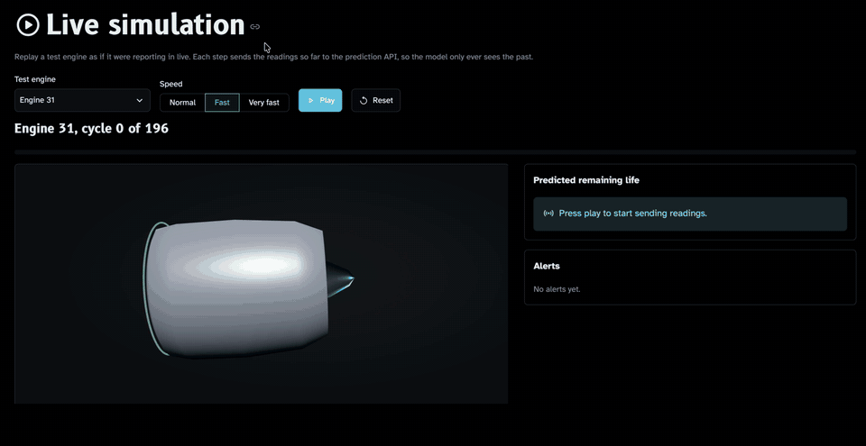
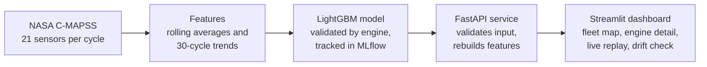

# Turbofan engine remaining useful life

A machine learning system that reads a jet engine's sensor history and predicts
how many flight cycles it has left before it fails, so maintenance can be
planned before a breakdown instead of after one. Built on NASA's C-MAPSS
turbofan dataset, from raw data to a tested model, a prediction API, and a live
dashboard.

**Live dashboard:** [azizdaim-turbofan.streamlit.app](https://azizdaim-turbofan.streamlit.app)
(after a quiet spell it sleeps, and the first visit needs a wake-up click)



## Highlights

- **Typical error of about 13 cycles** on 100 test engines the model never saw,
  falling to about 7 cycles when an engine is close to failure, where accuracy
  matters most.
- **Trend features were the breakthrough.** Adding each sensor's 30-cycle trend
  cut test error from 17.1 to 13.1 cycles, and an ablation study confirmed the
  model relies on them more than on anything else.
- **Warnings come early enough to act on.** In the replay above, engine 31 is
  flagged for watching with 59 cycles truly left and for replacement with 24.
- **Half the features, same accuracy.** The ablation study showed 32 of the 62
  candidate features were redundant, so the served model uses the other 30.
- **It can tell when new data does not fit.** A drift check raises no false
  alarm on the training scenario and flags both of NASA's harder scenarios,
  where the model's error rises from 13 to 22 and 45 cycles.

## How it works



1. **Data.** Each training engine runs from healthy to failure, logging 21
   sensors and 3 settings every flight cycle. The target is cycles left until
   failure, capped at 125, since a healthy engine's exact remaining life cannot
   be read from its sensors.
2. **Features.** For each of the 15 sensors that change, a 5-cycle rolling
   average smooths noise and a 30-cycle trend captures slow wear. Both look only
   backwards, so no feature uses information from the future.
3. **Model.** A LightGBM regressor, validated with 5-fold cross-validation that
   splits by engine rather than by row. Rows from one engine are near-copies of
   each other, so a row-level split would leak answers and flatter the scores.
4. **API.** A FastAPI service checks each request with Pydantic, rebuilds the
   same features, and returns a prediction for the latest cycle or every cycle.
   A drift endpoint checks whether a batch of engines still looks like the
   training data.
5. **Dashboard.** Every number on the dashboard comes from the API. Its look
   follows an aircraft engine-indication display: green, amber, and red for
   health, magenta for predictions, and Airbus's B612 cockpit typeface.

| Layer | Tools |
|-------|-------|
| Data and modeling | pandas, NumPy, scikit-learn, LightGBM |
| Experiment tracking | MLflow |
| Serving | FastAPI, Pydantic, Uvicorn |
| Dashboard | Streamlit, ECharts, three.js (a 3D engine built in code) |
| Monitoring | Population Stability Index drift check, built on NumPy |
| Quality | pytest (80 tests), Ruff |
| Delivery | Docker (multi-stage build), GitHub Actions |

## Engineering

What keeps the system trustworthy outside a notebook:

- **One feature pipeline for training and serving.** The API rebuilds features
  from raw readings with the same function used in training, so serving cannot
  drift from training. Clients never compute features themselves.
- **Validation at the boundary.** Pydantic rejects requests with a missing
  sensor, cycle numbers that do not strictly increase, or more than 1,000
  cycles, with a clear 422 error, before anything reaches the model.
- **Outputs kept in range, with honest warnings.** Predictions are clipped to
  the training range of 0 to 125 cycles, and histories of 30 cycles or fewer
  come back with a reliability warning.
- **Features that provably cannot see the future.** Tests check that cutting an
  engine's history short never changes its earlier features, so offline scores
  reflect what the model can do live.
- **Continuous integration.** Every push runs Ruff and the 80 tests, then builds
  the Docker image from scratch, downloading NASA's data and training the model,
  and smoke-tests the running container with a live drift request.
- **Reproducible builds.** The app's dependencies are pinned to exact versions,
  and the multi-stage Dockerfile trains in one stage and ships only what the
  running app needs in the other.
- **Experiment tracking.** Every training run logs its settings,
  cross-validation scores, and model to MLflow.
- **Drift monitoring.** A `/drift` endpoint compares a batch of new engines with
  the training data, sensor by sensor, before their predictions are trusted.

## Results

Scored on NASA's FD001 subset: 100 training engines and 100 test engines, each
test engine cut off at an unknown point before failure.

| Evaluation | RMSE (cycles) | NASA score per engine |
|------------|---------------|-----------------------|
| Cross-validation (mean ± std across folds) | 11.90 ± 0.56 | 2.86 ± 0.42 |
| Test, labels capped at 125 | 13.07 | 2.85 |
| Test, raw labels | 14.34 | 3.18 |

- **RMSE** is the typical prediction error in cycles; lower is better.
- **NASA score** is the competition metric. It punishes late predictions, which
  would let an engine fail, more heavily than early ones.
- **Near failure** (true remaining life under 50 cycles), cross-validated RMSE
  is 6.81 ± 0.42.

Cross-validation scores average 50 random cut-off points per validation engine,
mimicking how the test engines are cut off. LightGBM settings (depth 5, learning
rate 0.03, 300 trees) were chosen from a 27-setting grid. Test scores were viewed
while diagnosing an earlier experiment, so they are not a fully untouched
estimate; every modeling choice was made from cross-validation.

## Ablation study

Which inputs does the model actually rely on? Each group of features was removed
in turn and the model re-scored with the same engine-grouped cross-validation,
repeated over 3 shuffles.

- **The 30-cycle trends carry the model.** Without them, near-failure error rises
  from 6.9 to 17.2 cycles.
- **Raw readings, rolling spreads, and settings are redundant.** Removed together,
  all 32 of them, accuracy did not drop (RMSE −0.05, worse in 0 of 3 shuffles).
  FD001 has one operating condition, so the settings carry no signal.
- **Every engine section matters.** The high-pressure compressor matters most,
  though it also has the most sensors.

<details>
<summary>Full ablation tables</summary>

A positive change means the model got worse without that group. Run it with
`python -m src.models.ablation`; results are saved in
[reports/ablation_results.csv](reports/ablation_results.csv).

**By feature type** (all 62 candidate features: RMSE 12.10, near-failure RMSE 6.92)

| Removed | Features | RMSE change | Near-failure change | Worse in |
|---------|----------|-------------|---------------------|----------|
| 30-cycle trends | 15 | **+6.62** | **+10.24** | 3 of 3 |
| Rolling averages | 15 | +0.19 | +0.75 | 3 of 3 |
| Operating settings | 2 | +0.00 | +0.00 | 2 of 3 |
| Raw sensor readings | 15 | −0.01 | −0.02 | 1 of 3 |
| Rolling spreads | 15 | −0.06 | −0.05 | 0 of 3 |

**By engine section** (all features built from that section's sensors)

| Removed | Sensors | RMSE change | Near-failure change | Worse in |
|---------|---------|-------------|---------------------|----------|
| High-pressure compressor | 3, 7, 9, 11, 14 | **+2.04** | **+2.46** | 3 of 3 |
| Fan | 6, 8, 13, 15 | +0.63 | +0.78 | 3 of 3 |
| Combustor | 12, 17 | +0.38 | +0.73 | 3 of 3 |
| Low-pressure turbine | 4, 21 | +0.32 | +0.41 | 3 of 3 |
| Low-pressure compressor | 2 | +0.15 | +0.15 | 3 of 3 |
| High-pressure turbine | 20 | +0.09 | +0.07 | 3 of 3 |

</details>

## Drift check

A model fails quietly when new data stops looking like its training data: it
keeps answering with the same confidence, only worse. NASA's other scenarios
make good test fleets, so the served model was run on two of them.

| Fleet | What changes | Sensors drifted | Model error (RMSE) |
|-------|--------------|-----------------|--------------------|
| FD001 test | Nothing, the training scenario | 0 of 14 | 13.1 cycles |
| FD003 | A second fault type, fan wear | 7 of 14 | 22.5 cycles |
| FD002 | Six operating conditions | 14 of 14 | 45.0 cycles |

Each sensor gets a Population Stability Index (PSI): the training readings are
split into ten buckets, and PSI measures how far a new fleet's share of each
bucket has moved. Below 0.1 is stable and 0.25 or more is drifted.

The first version raised a false alarm. Comparing every cycle flagged 8 of 15
sensors on FD001's own test engines, because test engines stop partway through
life and are healthier on average than training engines, which all run to
failure. Wear looked like drift. Comparing only each engine's first 30 cycles,
while it is still new, removed the false alarm, and the drift scores now rank
the fleets in the same order as the model's error. On FD003, the sensor that
moves most is a fan sensor, which matches its added fan fault.

The errors come from `python -m src.monitoring.drift`, saved in
[reports/drift_results.csv](reports/drift_results.csv); the dashboard's Drift
check page runs the sensor comparison live through the API.

## Key findings

**How a model is tested matters as much as the model.** Each engine contributes
about 200 rows that look almost the same, so splitting rows at random puts
near-copies of one engine in both training and validation, and the model gets
graded on answers it has effectively seen. Splitting by engine fixed that. The
scores were also noisy: with 20 engines per validation fold, a single random
cut-off per engine moved results by more than the settings I was comparing, so
each score averages 50 cut-offs. One comparison made the point clear. A 20-cycle
rolling window beat a 5-cycle window in cross-validation but lost on the test
set, yet three test engines accounted for the whole test gap, and on engines
close to failure the two were tied. Differences that small are noise, and the
test set is not for choosing settings.

**Where a sensor is heading says more than where it is.** Engines start life
with different amounts of wear and small manufacturing differences, so a reading
that is normal for one engine can be a warning sign for another. Wear shows up
as a slow drift buried in noise: rolling averages remove the noise, and 30-cycle
trends measure the drift. That is why trends cut test error from 17.1 to 13.1
cycles, and why removing them more than doubles the error near failure.

**Features should be tested together, not just one at a time.** Removing raw
readings, rolling spreads, or settings one at a time barely changed the error,
but that alone does not prove they are useless: overlapping features can cover
for each other. Removing all 32 at once settled it. Accuracy held, so the served
model uses 30 features instead of 62, which makes it simpler to explain and
gives it less noise to memorize.

**Not all errors cost the same.** Predicting too much remaining life lets an
engine fail in service; predicting too little only replaces it early. So error
near failure is reported separately, the NASA score punishes late predictions
harder, and the dashboard's warning bands are generous, flagging an engine for
watching at 60 predicted cycles. The same reasoning caps the target at 125
cycles: early in an engine's life its sensors look healthy whether 150 or 300
cycles remain, so the model is trained to say "healthy" instead of guessing.

## Run it

**With Docker** (one command, no local setup). The image downloads NASA's data,
trains the model, and runs the API and the dashboard together.

```bash
docker build -t turbofan-rul .
docker run -p 7860:7860 turbofan-rul   # then open http://localhost:7860
```

**For development**, with Python 3.12:

```bash
python -m venv venv
source venv/bin/activate
pip install -r requirements.txt

# Download the C-MAPSS data from NASA's public repository into data/raw
mkdir -p data/raw
curl -L -o cmapss.zip "https://phm-datasets.s3.amazonaws.com/NASA/6.+Turbofan+Engine+Degradation+Simulation+Data+Set.zip"
unzip -j cmapss.zip "*/CMAPSSData.zip"
unzip -j -o CMAPSSData.zip "train_*" "test_*" "RUL_*" -d data/raw
rm cmapss.zip CMAPSSData.zip

pytest                                   # run the tests
python -m src.models.train               # train and log the run to MLflow
mlflow ui --backend-store-uri ./mlruns   # browse experiments

uvicorn src.api.main:app --reload        # API docs at http://127.0.0.1:8000/docs
streamlit run src/dashboard/app.py       # in a second terminal
```

Add `?autoplay=1` to the simulation page's address to start the replay on
arrival. The hosted demo runs on Streamlit Community Cloud, which runs a single
Streamlit app, so there `RUL_EMBEDDED_API=1` starts the API in a background
thread of the dashboard's process; the dashboard still calls it over HTTP.

## API

| Endpoint | Method | Purpose |
|----------|--------|---------|
| `/health` | GET | Reports that the service is running |
| `/predict` | POST | Predicts remaining life at an engine's latest cycle |
| `/predict/history` | POST | Predicts remaining life at every cycle of an engine's history |
| `/model/info` | GET | Returns how the served model scored when it was trained |
| `/drift` | POST | Checks a batch of engines' early-life readings for drift from the training data |

The prediction endpoints take a list of cycles, oldest first, each with the
cycle number, 3 settings, and 21 sensors in the C-MAPSS format. Histories of 30
cycles or fewer get a warning, because the trend features need a longer history.
`/drift` takes a list of such engine histories and returns a PSI and status for
each sensor. Interactive documentation is served at `/docs`.

**Example.** Send an engine's history, oldest cycle first (abbreviated here):

```bash
curl -X POST http://127.0.0.1:8000/predict \
  -H "Content-Type: application/json" \
  -d '{"cycles": [{"cycle": 1, "setting_1": -0.0019, "setting_2": -0.0004,
                   "setting_3": 100.0, "sensor_1": 518.67, "sensor_2": 642.75,
                   ..., "sensor_21": 23.4048},
                  ...]}'
```

For test engine 31, all 196 cycles, where NASA's answer file says 8 cycles were
left:

```json
{"predicted_rul": 9.16, "last_cycle": 196, "cycles_received": 196, "warning": null}
```

The same engine's first 20 cycles only:

```json
{
  "predicted_rul": 124.96,
  "last_cycle": 20,
  "cycles_received": 20,
  "warning": "Only 20 cycles received. Trend features need more than 30, so this prediction is less reliable."
}
```

## Project structure

```
├── src/
│   ├── data/            # Loading and the remaining-life target
│   ├── features/        # Rolling and trend features, sensor-to-section mapping
│   ├── models/          # Training, cross-validation, ablation study
│   ├── evaluation/      # RMSE and NASA scoring
│   ├── monitoring/      # Drift check: PSI on early-life sensor readings
│   ├── api/             # FastAPI prediction service
│   └── dashboard/       # Streamlit pages, charts, 3D engine, in-process API
├── tests/               # pytest suite
├── notebooks/           # Exploratory data analysis
├── reports/             # Ablation study and drift results
├── models/              # The served model and its scores
├── data/raw/            # NASA data; only the files the tests and dashboard read are committed
├── docs/                # README media
├── scripts/             # Starts the API and dashboard in the container
├── Dockerfile           # Trains the model, then runs the API and dashboard
├── requirements.txt     # Everything for development
└── requirements-app.txt # Only what the running app needs, pinned
```

## Limitations and next steps

- **One simulated scenario.** The model is trained on FD001: one operating
  condition and one fault mode from NASA's simulator, not real flight data. The
  drift check catches the harder scenarios, but the model does not handle them;
  that would need training on them, with features normalized per operating
  condition.
- **A slow start.** Trend features need more than 30 cycles of history, so
  predictions for very young engines are less reliable, and the app says so.
- **Drift is checked, not watched.** The drift check runs on demand for a
  batch of engines; a production system would run it on a schedule and alert.

## Data and license

The C-MAPSS dataset was created by NASA's Prognostics Center of Excellence
(Saxena et al., 2008) and is publicly available from the
[NASA data repository](https://www.nasa.gov/intelligent-systems-division/discovery-and-systems-health/pcoe/pcoe-data-set-repository/).
The code is released under the [MIT license](LICENSE).
